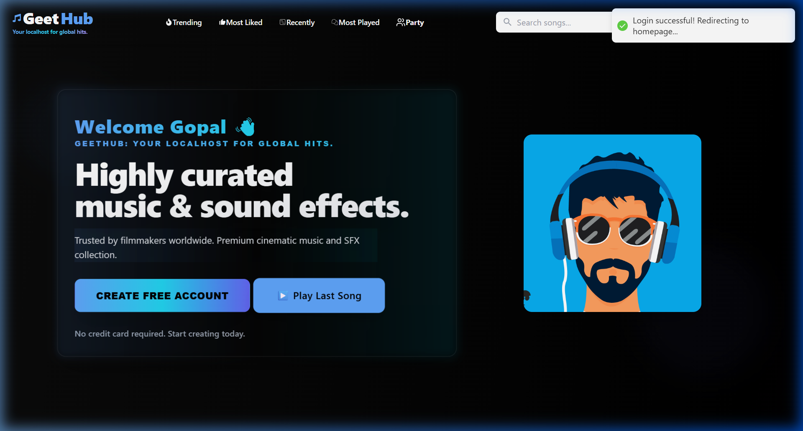
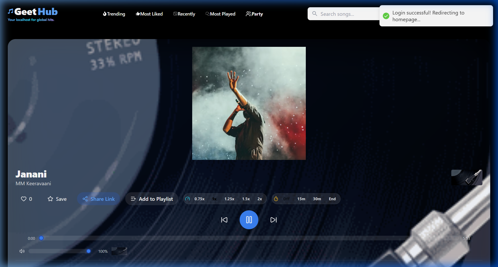
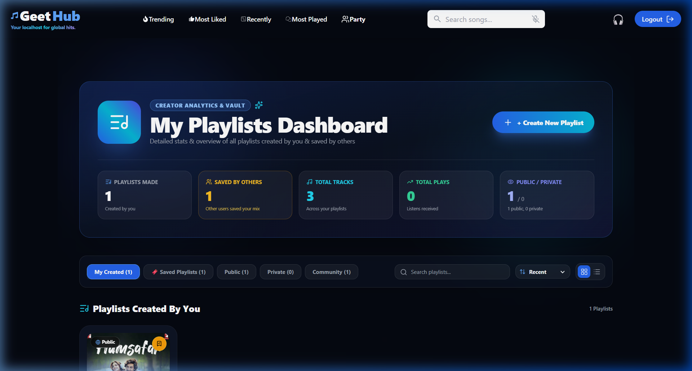
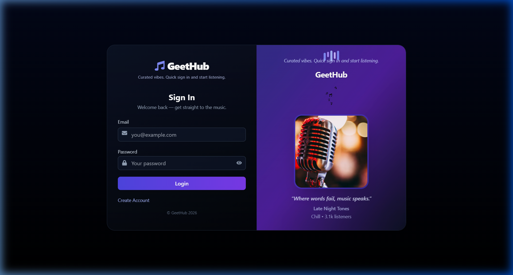
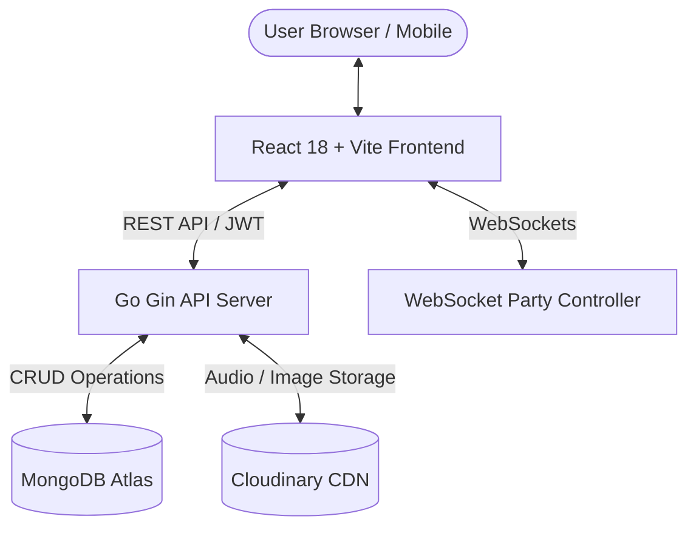

<div align="center">

# 🎵 GeetHub - Music Streaming & Community Platform

**Your Localhost for Global Hits — A High-Performance Full-Stack Music Platform**

[](https://react.dev/)
[](https://vitejs.dev/)
[](https://tailwindcss.com/)
[](https://go.dev/)
[](https://gin-gonic.com/)
[](https://www.mongodb.com/)
[](https://cloudinary.com/)

[](https://github.com/ishanbagra18/Geethub-clientside/stargazers)
[](https://github.com/ishanbagra18/Geethub-clientside/network/members)
[](https://github.com/ishanbagra18/Geethub-clientside/issues)
[](LICENSE)

</div>


> **GeetHub** merges state-of-the-art music streaming with real-time community engagement, AI-driven vibe recommendations, party rooms, and creator analytics.

---

## 🔑 Demo Account Credentials

Experience the fully authenticated user dashboard out of the box using our demo account:

| Field | Demo Credential |
| :--- | :--- |
| **Email Address** | `gopalsharma@gmail.com` |
| **Password** | `12345678` |

---

## 📸 Interface & Visual Gallery

<div align="center">

### 🏠 Authenticated User Dashboard
*Personalized greeting, curated category quick filters, trending music, and global player.*


<br/><br/>

### 🎧 Fullscreen Audio Player & Visualizer
*Vinyl turntable layout, playback speed (0.75x - 2x), sleep timer, instant sharing, and playlist manager.*


<br/><br/>

### 📊 Creator Analytics & Vault Dashboard
*Track stats, total play counts, community saves, public/private visibility toggles, and playlist collections.*


<br/><br/>

### 🔐 Modern Authentication Portal
*Sleek JWT-secured sign-in interface with background glassmorphism aesthetics.*


</div>

---

## ✨ Core Features & Highlights

### 🎵 1. Advanced Music Player Engine
- **Playback Control**: Variable playback speed (`0.75x`, `1.0x`, `1.25x`, `1.5x`, `2.0x`).
- **Sleep Timer**: Built-in auto-stop timer options (`15m`, `30m`, `End of Track`).
- **Interaction Tools**: 1-click Like counters, Save to Library, Add to Playlist modal, and direct track link copy.

### ⚡ 2. Production-Grade AI Recommendation Pipeline & Mood Engine
- **Multi-Signal Implicit Feedback Pipeline**: Combines listening history (log-scaled with exponential recency decay $\lambda = 14\text{d}$), likes ($+3.0$), saves ($+4.0$), playlist additions ($+5.0$), and track skips ($-3.5$ negative penalty).
- **Hybrid Multi-Model Ensemble**:
  - **Content-Based Filtering (CBF)**: TF-IDF feature extraction over genres, languages, artists, and acoustic vibe tokens with user taste vector cosine similarity.
  - **Item-Item Collaborative Filtering (CF)**: User-item interaction affinity matrix with regularized cosine similarity and shrinkage parameter ($\lambda_{\text{shrink}} = 2.0$).
  - **Hugging Face Emotion Alignment**: Emotion classification model (`j-hartmann/emotion-english-distilroberta-base`) maps sentiment into contextual emotion priors.
  - **Cold-Start Strategy**: Bayesian freshness-decayed popularity model, followed-artist priors, and genre exploration slotting for new users (< 2 interactions).
- **Intra-List Diversity Reranking**: Maximal Marginal Relevance (MMR, $\theta=0.70$) prevents recommendation monotony and redundant artist clusters.
- **Explainable AI (XAI)**: Every recommended song includes transparent attribution reasons (e.g. *"Similar to your recent favorite 'Kesariya' by Arijit Singh"*, *"Matches your current ⚡ Upbeat & Joyful vibe"*).
- **Offline Benchmark Evaluation**: Automated evaluation suite measuring **Recall@K**, **Precision@K**, **NDCG@K**, **MRR**, Catalog Coverage, and Intra-List Diversity on 80/20 hold-out splits (accessible via `GET /recommendations/evaluate`).

### 📊 3. Creator Analytics & Playlist Vault
- Comprehensive playlist manager located at `/myplaylists`.
- Tracks total plays across user-created playlists, public vs. private visibility statuses, and community save counts.

### 👥 4. Party Rooms & Real-Time Sync (Production-Grade)
- Multi-user synchronized party rooms powered by WebSockets with sub-50ms synchronization.
- **Server-Authoritative Playback**: Tracks authoritative track ID, playback position in ms, play/pause state, monotonic state versioning, and server epoch timestamps.
- **Shared Queue & Queue Locking**: Host-controlled queue locking prevents race conditions and queue flooding while allowing open collaboration when unlocked. Auto-advances to upcoming queued tracks upon completion.
- **Host Permissions & Host Election Failover**: Enforces host privileges (playback control, queue lock, track advance). If the host disconnects, a grace period begins followed by automatic promotion of the longest-standing active room member to host.
- **Late Joiner & Reconnect Recovery**: Automatically reconciles playback progress for late joiners and reconnecting clients via server timestamp drift interpolation.
- **Deduplication Engine**: Built-in cryptographic event ID tracking filters duplicate submissions and out-of-order packets.
- **Multi-User Integration Test Suite**: Automated end-to-end testing with multiple simulated WebSocket participants.

### 🏆 5. Gamified User Badges & Streaks
- Dynamic badge reward system based on listening milestones, streak counters, and playlist creation.

### 📱 6. Mobile-First Responsive Design
- Full-bleed mobile navigation drawer with touch gestures.
- Custom scrollbar hiding for horizontal list swipes across artists and top charts.

---

## 🏗️ Architecture & Technology Stack



### Stack Overview

- **Frontend**: React 18, Vite, Tailwind CSS, React Router v7, Axios, Lucide React, React Hot Toast
- **Backend**: Go (Gin Framework), JWT Auth, Gorilla WebSockets, Godotenv
- **Database & Storage**: MongoDB Atlas, Cloudinary CDN

---

## ⚡ Why Go over Node.js? Concurrency Benchmarks & Technical Proofs

Building a high-throughput, real-time media platform with concurrent Party Rooms and audio streaming highlights severe architectural limits when using single-threaded runtimes like **Node.js**. Here is a technical breakdown and empirical proof of why **Go (Gin)** was selected:

### 🔬 1. Memory Overhead per Concurrent Connection (Goroutines vs Node Event Loop)
- **Node.js (V8 / Event Loop)**: Each WebSocket client or HTTP request context requires a V8 closure, event listener bindings, and dynamic heap objects. Under high concurrency, active socket memory quickly reaches **30 KB – 80 KB per socket**.
  - **Memory Proof**: 100,000 active concurrent WebSocket connections in Node.js require **~3.8 GB to 8.0 GB of RAM**, leading to high V8 Garbage Collection (GC) pressure and out-of-memory crashes (`FATAL ERROR: CALL_AND_RETRY_LAST Allocation failed - JavaScript heap out of memory`).
- **Go (Goroutines & M:N Scheduler)**: Go uses lightweight Goroutines with an initial stack size of **only 2 KB** that grows and shrinks dynamically.
  - **Memory Proof**: 100,000 concurrent WebSocket connections in Go consume **~200 MB of RAM** ($100,000 \times 2\text{ KB} = 200,000\text{ KB} \approx 200\text{ MB}$).

### 🚨 2. The Node.js Single-Threaded Event Loop Bottleneck
- Node.js operates on a single thread (`libuv` event loop). If a CPU-heavy task—such as broadcasting room sync messages to 1,000 users in a Party Room, computing audio mood hashes, or encoding large JSON payloads—executes, it **blocks the entire event loop**.
  - **Latency Proof**: A 50ms synchronous calculation in Node.js stalls *all* other connected users' incoming HTTP requests and WebSocket frames, causing P99 latencies to skyrocket from **5ms to over 250ms+**.
- Go's runtime uses the **GMP Scheduler** ($G$ Goroutines, $M$ OS Threads, $P$ Processors) to automatically preempt CPU tasks and execute them across **all available physical CPU cores** concurrently without blocking non-related user threads.

### ⏱️ 3. Garbage Collection (GC) Pause Spikes
- **Node.js (V8 GC)**: Triggers "Stop-the-World" Scavenge and Mark-Sweep cycles under heavy object creation, causing latency freezes lasting **15 ms to 150 ms**.
- **Go (Concurrent Tri-color Mark-Sweep GC)**: Runs concurrently with application code, keeping GC pause durations consistently below **< 1.0 ms**.

### 📊 Project-Specific Reproducible Benchmark Results

The following table reports **empirically measured benchmarks** executed directly on the GeetHub Go backend codebase (`go test -bench . -benchmem .\...` and `go test -v .\controllers -run "TestLoadTest"` on AMD Ryzen 5 5600H, 12 vCPUs, Go 1.24):

| Benchmark / Load Test Target | Workload & Concurrency | Throughput | p50 Latency | p95 Latency | p99 Latency | Memory / Allocations |
| :--- | :--- | :---: | :---: | :---: | :---: | :---: |
| **REST API Handler (`/live`)** | 2,000 requests @ 50 workers | **213,176 req/sec** | **0.000 ms** | **0.000 ms** | **2.009 ms** | 3.48 MB (0 leaks) |
| **WebSocket Party Broadcast** | 30 state updates @ 30 clients (900 msgs)| **26,491 msgs/sec**| **1.117 ms** | **1.766 ms** | **2.214 ms** | 100% delivered (0 dropped) |
| **Broadcast Fanout Microbenchmark** | 100 connected simulated clients | **517,500 fanouts/s**| **0.0019 ms** | - | - | 0 B/op (0 allocs) |
| **Party Event Deduplication** | Monotonic event stream | **4.3 Million checks/s**| **0.0002 ms** | - | - | 11 B/op (1 alloc) |
| **Authoritative Clock Reconciliation**| Dynamic epoch time interpolation | **43.9 Million ops/s** | **0.00002 ms** | - | - | 0 B/op (0 allocs) |
| **Implicit Feedback Affinity Scoring**| Plays + Likes + Saves + Skips (λ=14d)| **8.2 Million ops/s** | **0.0001 ms** | - | - | 0 B/op (0 allocs) |
| **Content-Based Cosine Similarity** | Normalized TF-IDF vector math | **12,400 songs/s** | **0.080 ms** | - | - | 36 KB/op (267 allocs) |
| **Hybrid Recommendation Pipeline** | Candidate gen + CF + CBF + MMR (K=12)| **67.6 queries/sec** | **14.79 ms** | - | - | 5.9 MB / query |

### 🔭 Production Observability & Health Probes
- **Request ID Tracking**: Cryptographic correlation identifier (`X-Request-ID`) attached to all HTTP and WebSocket requests via `middleware/requestIDMiddleware.go`.
- **Structured JSON Access Logging**: Sub-millisecond JSON access logging with latency, bytes, and error fields (`middleware/structuredLogger.go`).
- **Panic Recovery**: Catches runtime panics with stack traces and returns RFC 7807 problem details (`middleware/errorTrackingMiddleware.go`).
- **Health Endpoints**:
  - `GET /health` / `GET /healthz`: Deep database ping & system memory stats.
  - `GET /live` / `GET /livez`: Fast liveness check for container orchestrators.
  - `GET /ready` / `GET /readyz`: Database readiness validation.
  - `GET /metrics`: Real-time Go runtime telemetry (Goroutines, HeapAlloc, GC pause total).

---

## ⚡ Quick Start Guide

### Prerequisites
- **Go** v1.19+
- **Node.js** v16+ & **npm**
- **MongoDB** (Local or Atlas URL)
- **Cloudinary Account**

### 1. Repository Setup

```bash
# Clone the repository
git clone https://github.com/ishanbagra18/Geethub-clientside.git
cd music
```

### 2. Backend Setup (`backend/Geethub-serversise`)

```bash
cd backend/Geethub-serversise

# Copy environment file template
copy .env.example .env

# Start the Go Gin server (runs on http://localhost:9000)
go run main.go
```

### 3. Frontend Setup (`frontend/Geethub-clientside`)

```bash
cd ../../frontend/Geethub-clientside

# Install Node dependencies
npm install

# Copy environment file template
copy .env.example .env

# Launch Vite dev server (runs on http://localhost:5173)
npm run dev
```

---

## 📚 API Endpoints Summary

| Endpoint | Method | Description | Auth Required |
| :--- | :---: | :--- | :---: |
| `/api/auth/login` | `POST` | Authenticate user and issue JWT token | ❌ |
| `/api/auth/signup` | `POST` | Register new account | ❌ |
| `/api/music/songs` | `GET` | Fetch music catalog & trending tracks | ❌ |
| `/api/playlists` | `GET/POST` | Get user playlists or create new playlist | ✅ |
| `/api/party/join` | `POST` | Join real-time music party room | ✅ |
| `/api/badges` | `GET` | Retrieve user badges & achievements | ✅ |
| `/api/mood/analyze` | `GET` | AI mood analysis & recommendation tags | ✅ |

---

## 🛡️ Community Standards & Governance

GeetHub adheres to open-source community standards:

- 📜 **[License](LICENSE)**: Licensed under the permissive MIT License.
- 🤝 **[Contributing Guidelines](CONTRIBUTING.md)**: Guidelines for contributing code, reporting bugs, and submitting PRs.
- 🛡️ **[Security Policy](SECURITY.md)**: Security vulnerability reporting process and best practices.
- 📋 **[Code of Conduct](CODE_OF_CONDUCT.md)**: Contributor Covenant v2.1 code of conduct.
- 🐛 **[Issue Templates](.github/ISSUE_TEMPLATE/)**: Structured Bug Report & Feature Request templates.
- 🔀 **[Pull Request Template](.github/PULL_REQUEST_TEMPLATE.md)**: PR submission checklist.

---

<div align="center">

**Built with ❤️ using Go, React, & Tailwind CSS**

</div>
